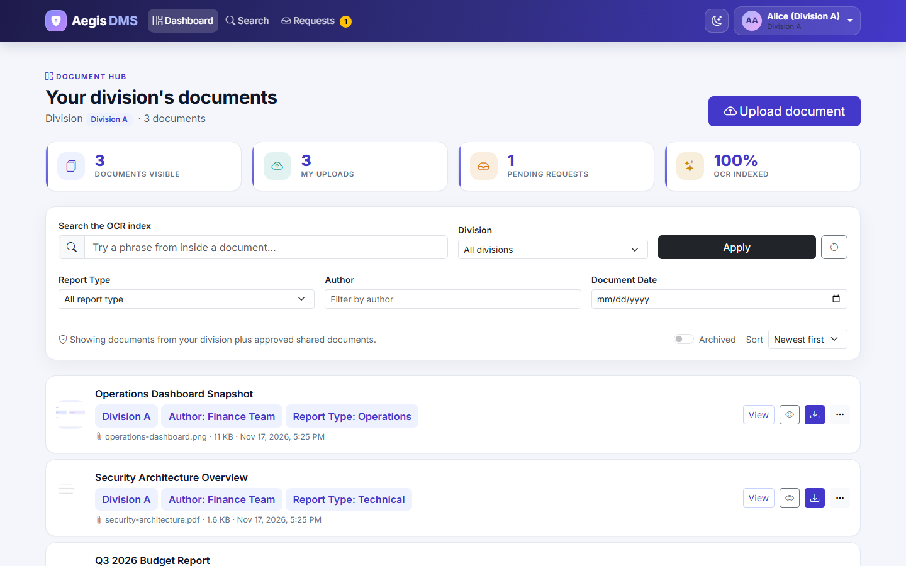
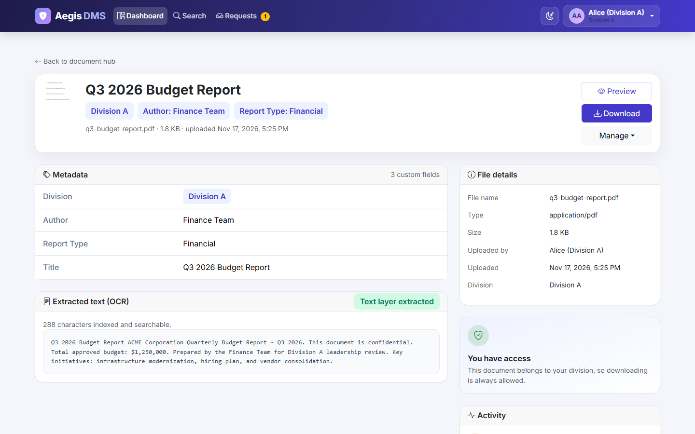
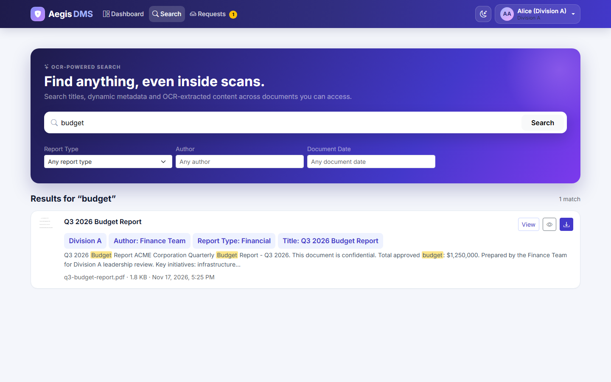
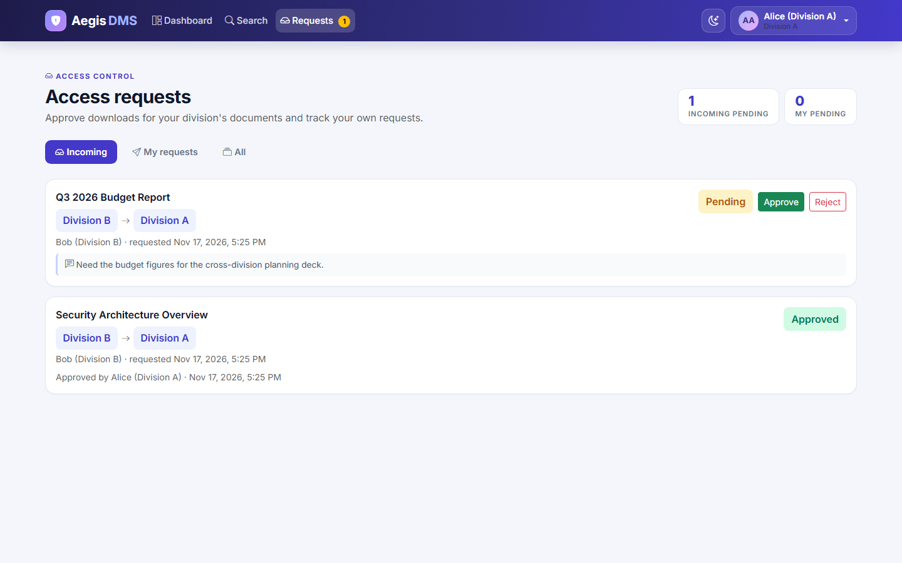
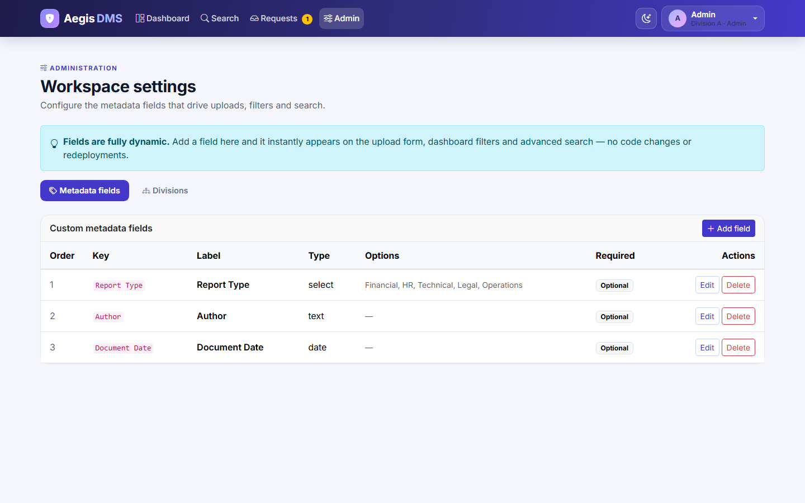
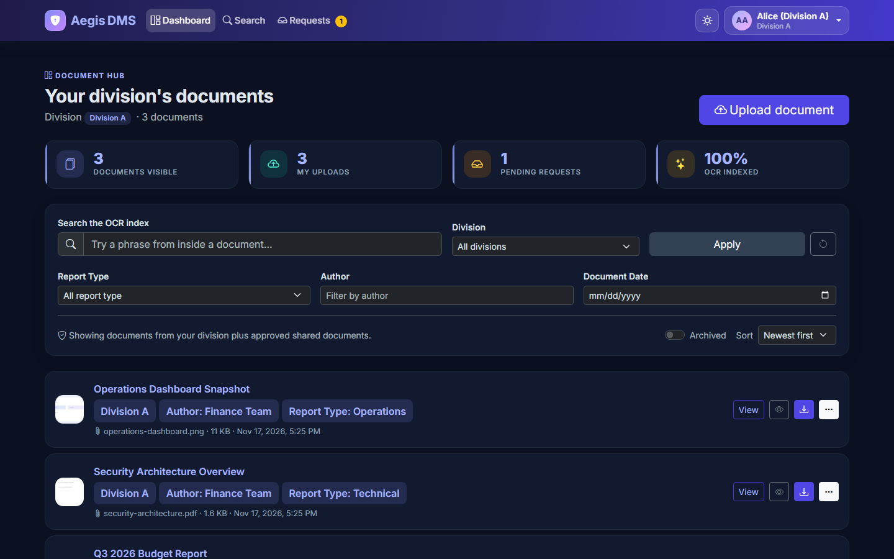

# Aegis DMS — by Triad AI

**Aegis** (Greek: *shield*) is a Flask + MongoDB document management system built for the Triad AI internship assignment. It supports **dynamic custom metadata**, **role-based access with division isolation**, a **cross-division access-request workflow**, **OCR-powered search**, in-browser previews, and an adaptive dark-mode UI.

## Features

- **Dynamic metadata** — metadata fields (e.g. `Report Type`, `Author`, `Document Date`) live in MongoDB and are managed from the Admin UI. Adding a field instantly updates the upload form, dashboard filters and search — no code changes.
- **RBAC & division isolation** — every user belongs to a division. Users upload only into their own division and, by default, only see documents from their division.
- **Cross-division access requests** — a user outside the owning division can request access; members of the owning division approve or reject from their inbox. Approved documents appear as "Shared" and become downloadable/searchable for the requester.
- **OCR & search** — digital PDFs use their text layer; scanned PDFs and images go through Tesseract. Extracted text is indexed and searchable together with titles and metadata, with highlighted snippets.
- **MongoDB GridFS** — all uploaded files are stored in GridFS; document records reference the GridFS file id.
- **Six UI views** — auth, document hub, document details, access-request inbox, advanced search, and admin settings.
- **JWT auth** — stateless HS256 tokens; passwords hashed with Werkzeug. The UI stores the token in `localStorage` and sends `Authorization: Bearer <token>`.
- **Private previews** — PDFs and images open in an in-app modal as blobs fetched with your token (never as public URLs). Small JPEG thumbnails are generated at upload time for PDFs and images.
- **Operations & audit** — uploaders and admins can archive/restore or delete documents; every document carries an activity timeline (uploaded, requested, approved/rejected, downloaded, archived, restored).
- **Dashboard** — live stat cards (visible documents, my uploads, pending requests, OCR-indexed), skeleton loading, archived toggle, dynamic filters, sorting, pagination, and multi-file upload.
- **Theme** — one-click light/dark mode that persists per browser; every surface is styled with CSS variables so both themes stay consistent.

## Screenshots

| Dashboard | Document details |
|---|---|
|  |  |

| Advanced search | Access requests |
|---|---|
|  |  |

| Admin settings | Dark mode |
|---|---|
|  |  |

## Tech stack

| Layer | Choice |
|---|---|
| Backend | Python 3.11, Flask 3 |
| Database | MongoDB 7, GridFS |
| Auth | PyJWT (HS256), Werkzeug password hashing |
| OCR | pytesseract + Tesseract, PyMuPDF (rendering), pypdf (PDF text layer), Pillow |
| UI | Jinja page shells, Bootstrap 5, vanilla JS (no build step) |
| Server | gunicorn (Docker), Flask dev server (local) |

## Project structure

```
.
├── app/
│   ├── __init__.py       # app factory, blueprint registration, error handlers
│   ├── config.py         # environment-driven configuration
│   ├── db.py             # MongoClient + GridFSBucket wiring
│   ├── models.py         # collection names, indexes, defaults (divisions, fields)
│   ├── auth.py           # register / login / me, JWT creation
│   ├── routes.py         # documents, upload, download, access, search, metadata, divisions
│   ├── utils.py          # RBAC helpers, serializers, pagination, decorators
│   ├── ocr.py            # text-layer extraction + Tesseract OCR pipeline
│   ├── views.py          # server-rendered page routes
│   ├── seed.py           # demo users
│   ├── templates/        # Jinja templates for the six views
│   ├── static/           # CSS + JS modules (api, theme, common, dashboard, document, search, requests, admin)
├── tests/
│   └── test_dms.py       # pytest suite (uses an isolated throwaway database)
├── test_api.py           # assignment-provided smoke test
├── Dockerfile
├── docker-compose.yml
├── requirements.txt
└── run.py
```

## Quick start (local)

Prerequisites: Python 3.11+, MongoDB running on `localhost:27017`, and (for OCR of scans) Tesseract installed and on `PATH`.

```sh
python -m venv .venv
.venv/Scripts/activate        # Windows; use source .venv/bin/activate on macOS/Linux
pip install -r requirements-dev.txt

# Optional: copy and edit environment defaults
cp .env.example .env

# Create demo users (safe to re-run)
python -m app.seed

# Run the app
python run.py
```

Open <http://localhost:5000>.

### Demo accounts

| Email | Password | Division | Role |
|---|---|---|---|
| admin@triad.ai | admin123 | Division A | admin |
| alice@triad.ai | alice123 | Division A | user |
| bob@triad.ai | bob123 | Division B | user |

New sign-ups default to the `user` role; any email listed in `ADMIN_EMAILS` is registered as `admin`.

## Quick start (Docker)

```sh
docker compose up --build
```

This starts MongoDB, seeds the demo accounts, and serves the app at <http://localhost:5000>. The `Dockerfile` installs Tesseract so scanned documents are OCR'd inside the container.

## Configuration

All settings are environment variables (see `.env.example`):

| Variable | Default | Purpose |
|---|---|---|
| `MONGO_URI` | `mongodb://localhost:27017` | MongoDB connection string |
| `MONGO_DB` | `triad_dms` | Database name |
| `SECRET_KEY` | dev value | Flask secret key |
| `JWT_SECRET` | `SECRET_KEY` | JWT signing secret |
| `JWT_EXPIRES_HOURS` | `24` | Token lifetime |
| `MAX_CONTENT_MB` | `25` | Max upload size |
| `REQUIRE_AUTH_FOR_UPLOAD` | `false` | See "Assignment test compatibility" below |
| `OCR_ENABLED` | `true` | Toggle OCR processing |
| `OCR_MAX_PAGES` | `15` | Pages OCR'd per PDF |
| `OCR_MAX_CHARS` | `200000` | Extracted text cap |
| `OCR_TIMEOUT_SECONDS` | `30` | Per-page OCR timeout |
| `TESSERACT_CMD` | auto-detected | Full path to `tesseract` if it is not on `PATH` (Windows default install is detected automatically) |
| `SEED_DEFAULTS` | `true` | Seed default divisions and metadata fields on start |
| `ADMIN_EMAILS` | `admin@triad.ai` | Comma-separated emails granted admin on registration |

## API reference

All JSON endpoints live under `/api`; authenticated endpoints expect `Authorization: Bearer <token>`.

### Auth

| Method | Path | Description |
|---|---|---|
| `POST` | `/api/auth/register` | `{name, email, password, division}` → `201` with `token`, `user` |
| `POST` | `/api/auth/login` | `{email, password}` → `200` with `token`, `user` |
| `GET` | `/api/auth/me` | Current user profile |

### Documents

| Method | Path | Description |
|---|---|---|
| `POST` | `/api/documents/upload` | Multipart: `file` + `metadata` (JSON string). Division comes from the user (or `metadata.Division` when anonymous). Returns `201`. |
| `GET` | `/api/documents` | Division-scoped list. Supports dynamic metadata filters (`?Report Type=Financial`), `division`, `archived`, `include_archived`, `sort`, `order`, `page`, `per_page`. |
| `GET` | `/api/documents/<doc_id>` | Details, including `has_download_access`, `request_status`, `ocr_excerpt`, `thumbnail`, `activity`, `archived`, `can_manage`. |
| `GET` | `/api/documents/<doc_id>/download` | Streams the file from GridFS. `403` without access. |
| `POST` | `/api/documents/<doc_id>/archive` | `{archived: true\|false}` — uploader or admin only. Returns the updated document. |
| `DELETE` | `/api/documents/<doc_id>` | Uploader or admin only. Removes the GridFS file, document record and its access requests. |
| `GET` | `/api/stats` | Dashboard counters: `documents`, `my_documents`, `ocr_indexed`, `ocr_coverage`, `pending_incoming`, `pending_outgoing`. |

### Access requests

| Method | Path | Description |
|---|---|---|
| `POST` | `/api/access/request` | `{doc_id}` → creates (or returns existing) request |
| `POST` | `/api/access/approve` | `{request_id}` — owning division only |
| `POST` | `/api/access/reject` | `{request_id}` — owning division only |
| `GET` | `/api/access/requests` | `?type=incoming\|outgoing\|all`, with pending counts |

### Search, metadata, divisions

| Method | Path | Description |
|---|---|---|
| `GET` | `/api/search` | `?q=` searches title, metadata and OCR text across accessible documents; returns highlighted `snippet` |
| `GET` | `/api/metadata-fields` | List dynamic fields |
| `POST` | `/api/metadata-fields` | Admin: create `{key, label, type, options, required, order}` |
| `PUT` | `/api/metadata-fields/<id>` | Admin: update (key is immutable) |
| `DELETE` | `/api/metadata-fields/<id>` | Admin: delete |
| `GET` | `/api/divisions` | List divisions (public) |
| `POST` | `/api/divisions` | Admin: create division |
| `GET` | `/api/health` | App + database health |

## Access rules

1. **Upload** — the document's division is the uploader's division. An authenticated user cannot upload into another division (`403`).
2. **Visibility** — `GET /api/documents` and `/api/search` return documents from the user's division plus documents the user has been approved to access.
3. **Download** — allowed for the uploader, any member of the owning division, and users with an approved request.
4. **Requests** — users cannot request access to their own division's documents (`400`). Approval/rejection is limited to members of the owning division and cannot be done by the requester (`403`). Duplicate pending/approved requests are returned instead of creating new ones.
5. **Admin** — metadata-field and division management require the `admin` role.

## OCR behavior

- `.txt` files are read directly.
- PDFs: the embedded text layer is used when it has meaningful content, otherwise pages are rendered with PyMuPDF and OCR'd with Tesseract (up to `OCR_MAX_PAGES`).
- Images: EXIF-corrected and OCR'd with Tesseract.
- Each document records `ocr_status` (`extracted`, `ocr`, `empty`, `unavailable`, `failed`, `skipped`) and the engine used, so the UI can explain exactly what happened. If Tesseract is not installed, uploads still succeed and the status is `unavailable`.

## Testing

Run the pytest suite (uses a temporary, randomly named database that is dropped afterwards):

```sh
pip install -r requirements-dev.txt
python -m pytest tests -q
```

Run the assignment-provided smoke test against a running server:

```sh
python test_api.py
# Summary written to test_report.txt
```

### Assignment test compatibility

The provided `test_api.py` uploads a file **without a token** to `/api/documents/upload`. To stay compatible, upload authentication is optional by default (`REQUIRE_AUTH_FOR_UPLOAD=false`); every other endpoint always requires auth. Set `REQUIRE_AUTH_FOR_UPLOAD=true` to require a token on upload as well.

## Troubleshooting

| Symptom | Fix |
|---|---|
| `pymongo.errors.ServerSelectionTimeoutError` | MongoDB is not running on `localhost:27017`. Start `mongod`/MongoDB Compass, or use `docker compose up`. |
| `ocr_status: "unavailable"` | Tesseract is not installed or not on `PATH`. Install it (Windows: `winget install UB-Mannheim.TesseractOCR`) and restart the app, or set `TESSERACT_CMD` in `.env`. |
| Port 5000 already in use | Stop the other process, or run `flask --app run` with a different `--port`. |
| Docker: `docker-credential-desktop` not found | Add `C:\Program Files\Docker\Docker\resources\bin` to `PATH` and reopen the terminal. |
| Upload returns `413` | The file exceeds `MAX_CONTENT_MB` (default 25 MB). |

## Requirement checklist

| Assignment requirement | Where it is implemented |
|---|---|
| Flask REST API | `app/routes.py` — upload, list, details, download, archive, delete, access requests, search, metadata, divisions, stats |
| File upload + metadata | `POST /api/documents/upload` with multipart `file` + JSON `metadata` |
| List documents with metadata filter (`?Report Type=Financial`) | `GET /api/documents` — any `metadata.<Key>` becomes a filter |
| Download | `GET /api/documents/<id>/download` (GridFS stream, permission-checked) |
| Cross-division access request flow | `POST /api/access/request`, `/approve`, `/reject`, `GET /api/access/requests` |
| Search by title / metadata / OCR text | `GET /api/search` with highlighted snippets |
| Dynamic metadata | Admin UI + `/api/metadata-fields`; fields stored in MongoDB |
| Role-based access & division isolation | `app/utils.py` RBAC helpers applied to every document route |
| MongoDB for metadata + file storage | PyMongo records + GridFS bucket |
| Six UI views | Login/Register, Dashboard, Document Details, Requests, Search, Admin Settings |
| Optional Docker | `Dockerfile` + `docker-compose.yml` (MongoDB + web + Tesseract) |
| Starter test compatibility | `REQUIRE_AUTH_FOR_UPLOAD=false`; verified with `test_api.py` |
| Authentication | JWT (HS256) with Werkzeug-hashed passwords |
| Responsive/"look & feel" | Bootstrap 5, custom CSS variables, dark mode, no horizontal overflow at 1366–1920 px |

## Submission

- Repository layout is self-contained: the Flask app, tests, Docker files and this README live at the repository root.
- Screenshots used above are in `docs/screenshots/`.
- A written project report (architecture, API reference, testing results, walkthrough) is included as `Aegis-DMS-Project-Report.pdf`.
